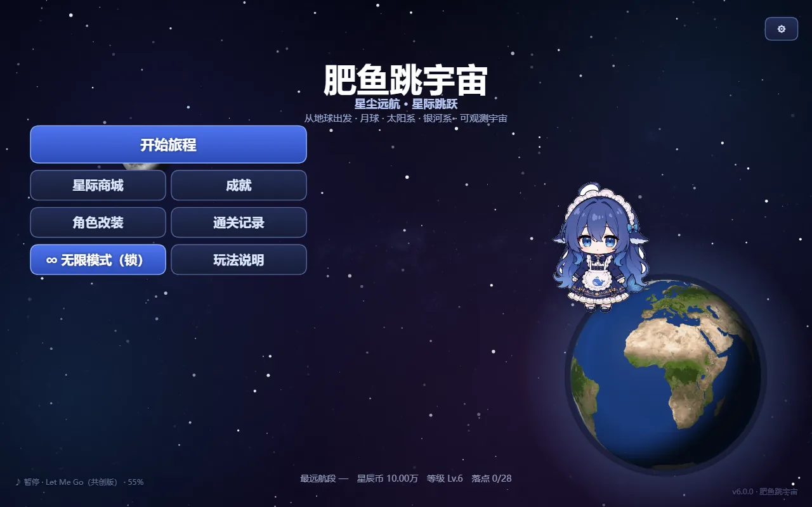
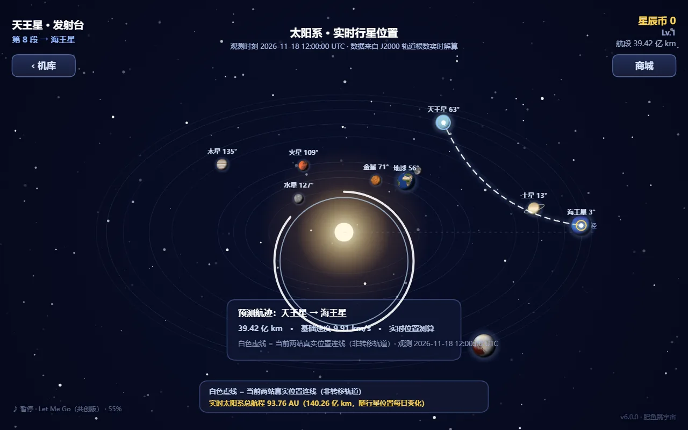
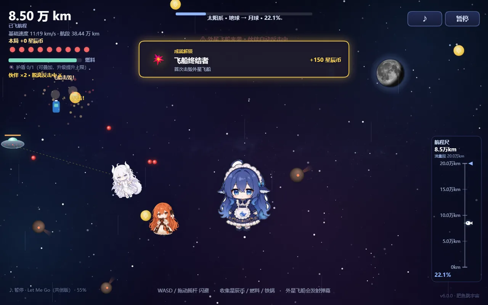
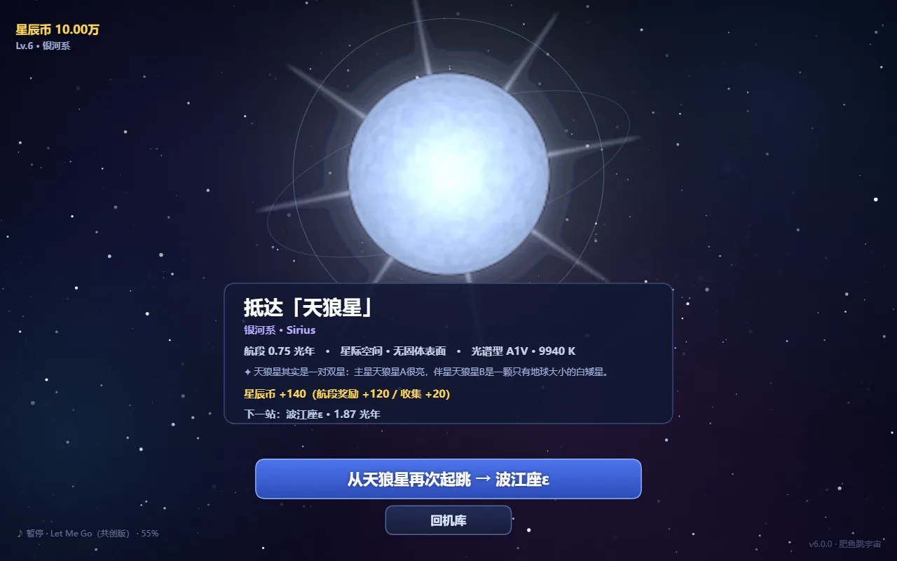
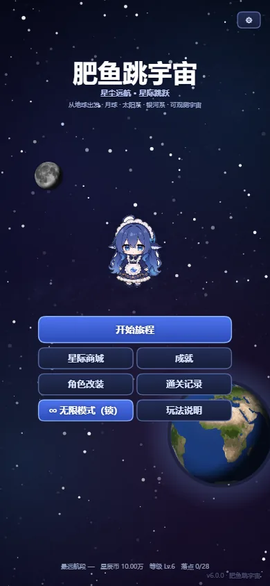
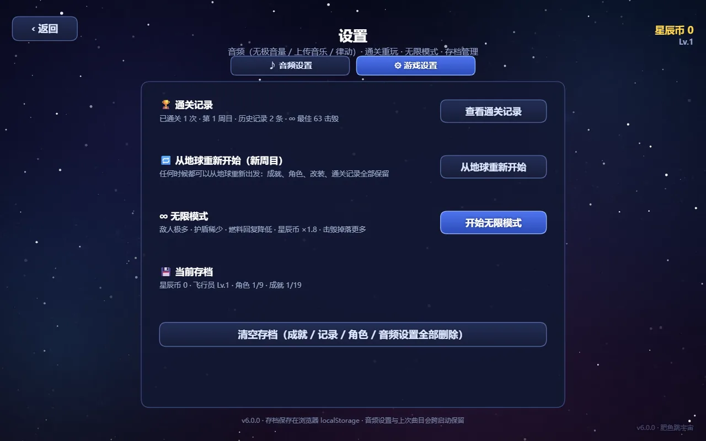
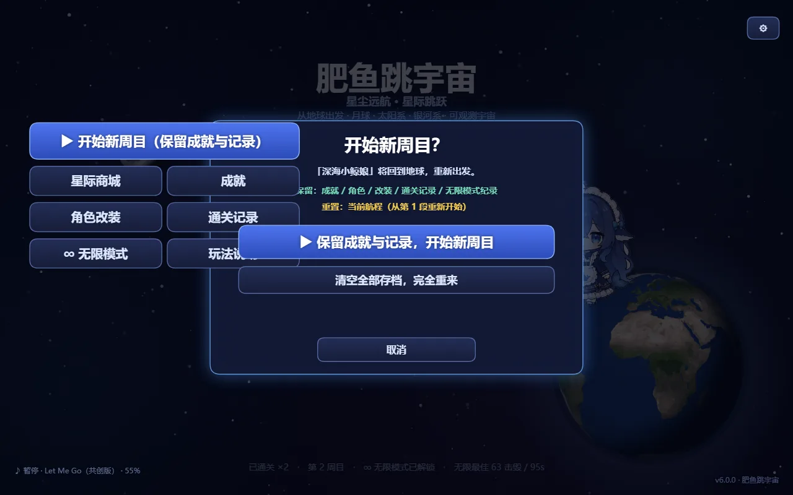
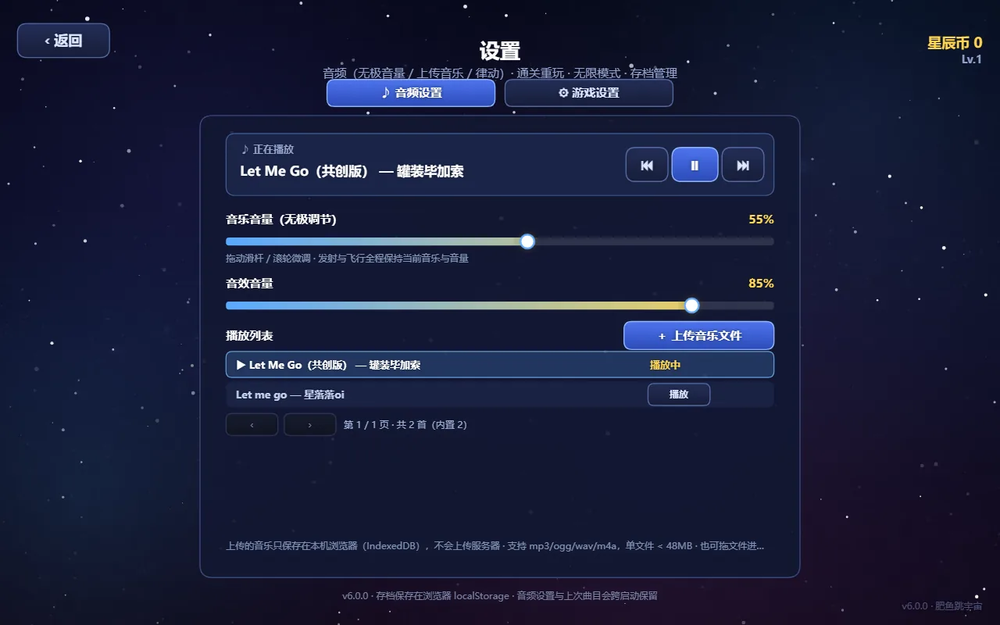
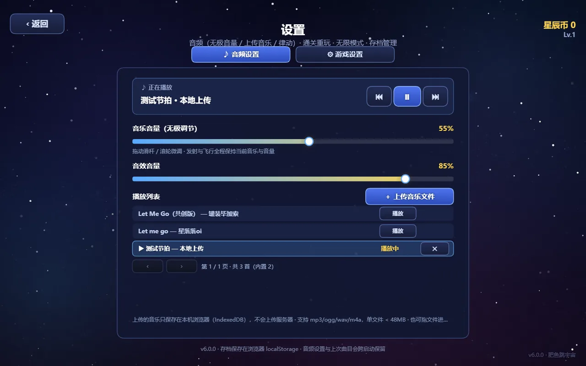
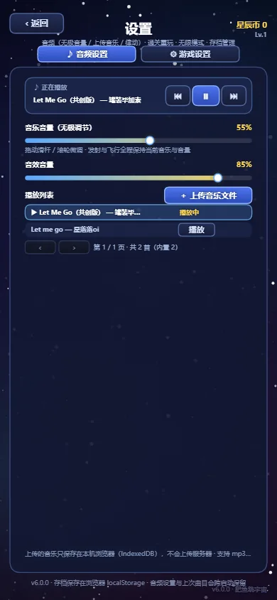

# 肥鱼跳宇宙 · 星尘远航

> **FatFish-Playable** — a single-file, dependency-free HTML5 canvas game: a chibi fish girl flies from
> Earth to the edge of the observable universe through 28 real astronomical stops, a real-time JPL
> solar system, 10 real stars and 9 AI mascot characters.
> Double-click `index.html` and play — no install, no build step, no network: everything is inlined.

一款由原生 JavaScript + Canvas 2D 写成的**单文件网页游戏**：从地球出发，经月球、太阳系八大行星、
冥王星、银河系 10 颗真实恒星、银河系中心，一路飞到可观测宇宙视界，共 **28 站**。
太阳系按**当前时刻的真实行星位置**实时解算，9 位 AI 拟人角色可收集 / 改装 / 编为伙伴同行；
通关后可开新周目、查看通关记录，或进入敌人数量爆炸的**无限模式**。


-green)




## 目录

- [特性](#特性)
- [截图](#截图)
- [玩法与操作](#玩法与操作)
- [快速开始](#快速开始)
- [自动化测试](#自动化测试)
- [项目结构](#项目结构)
- [技术栈](#技术栈)
- [数据与素材来源](#数据与素材来源)
- [已知限制](#已知限制)
- [部署到 GitHub Pages](#部署到-github-pages)
- [许可证](#许可证)
- [版本与文档](#版本与文档)

## 特性

- **实时太阳系**：用 JPL《Approximate Positions of the Major Planets》的 J2000 轨道根数
  实时解算 9 颗行星的黄经，地图按真实位置摆放；机库与地图显示观测时刻、各行星方位与
  **实时太阳系总航程**（随日期变化，2026-11-18 实测 93.76 AU）。2020–2035 年黄经误差
  实测最大 0.074°。
- **28 站真实航程**：地球 → 月球 → 水星 → 金星 → 火星 → 木星 → 土星 → 天王星 → 海王星 →
  冥王星 → 10 颗恒星 + 银河系中心 / 边缘 → 大麦哲伦云、仙女座、三角座、室女座、后发座 →
  可观测宇宙视界。每段距离都可在界面查看并复现。
- **9 位 AI 拟人角色**：DeepSeek / ChatGPT / Claude / Gemini / Grok / Kimi / GLM / Qwen /
  MiniMax，各有被动加成，商城 3 页分页购买。
- **伙伴自动反击**：最多携带 2 名伙伴（Lv.3 解锁），飞行中自动脱离编队攻击外星飞船，
  各自携带护盾且锅具样式不重复。
- **角色改装**：星辰币升级出战角色的生命值 / 护盾上限 / 操控加速度（各 0–5 级）。
- **飞行续存**：飞行中每 1.5 秒自动存档，退出后可「继续飞行」，不用回地球重来。
- **通关重玩 / 新周目（v5）**：当前周目通关后可「再玩一次」开新周目，进度回到地球重新出发，
  角色、改装、成就、通关历史与无限模式成绩全部保留（当前周目新达成的成就单独记录）。
  **v6.0.0 UX 修订**：单击主按钮会弹出明确确认框（保留成就开始新周目 / 清空全部存档完全重来 /
  取消），设置页「🔁 从地球重新开始（新周目）」**任何时候**都能用，不必先通关完当前周目。
- **通关历史记录（v5）**：每一次通关的时间、模式、出战角色、同行伙伴、本次新达成成就、
  击毁数、飞行员等级与星辰币都可分页查看（最新在前、最多保留 50 条）；每个角色还有单独的
  成就档案；界面同时显示无限模式最好成绩。
- **无限模式（v5）**：通关后解锁。同屏飞碟从 6 架起步、每 20 秒 +1 档（**封顶 9 架**），
  生成间隔 1.1–2.4 s；护盾掉落权重降到 **35%**、燃料拾取只回复 **18**（普通 36），
  星辰币收益 **×1.8**、击毁一艘掉落 **3–5 件**装备（普通 2–3 件）；记录存活秒数 /
  击毁数 / 星辰币的最好成绩。
- **真实贴图**：行星来自 Solar System Scope（CC BY 4.0）等真实天体贴图；太阳用 NASA SDO
  真实影像、银河系中心用 EHT Sgr A* 真实影像；仙女座等 4 个星系用 NASA / ESA 观测照片；
  其余 10 颗恒星按有效温度黑体色程序化重建（不同光谱型颜色各不相同）。
- **音频系统（v6）**：内置两首曲目（罐装毕加索《Let Me Go（共创版）》、星落落oi《Let me go》），
  设置 →「♪ 音频设置」里可**无极拖动**音乐 / 音效音量（滚轮微调 0.005）；支持上传本地音乐
  （mp3 / ogg / wav / m4a / webm，单文件 ≤ 48 MB，也可把文件拖进设置页），保存到浏览器
  **IndexedDB**、不上传服务器、下次打开仍在；播放时角色与伙伴随节拍做弹跳 / squash & stretch；
  `M` 音乐开关、`N` 下一首，切机库 / 发射台 / 飞行 / 结局全程不中断、音量与曲目保持。
- **零依赖单文件**：无框架、无 npm、无网络请求；构建把全部代码 + 贴图 + 两首音乐 base64
  内联进 `index.html`（8.876 MB / 9,089,288 B），可双击、可离线、可直接静态托管。

## 截图

以下截图全部来自 **v6.0.0 最终构建**（桌面 1280×800 / 手机 390×844，headless Chrome 实拍），
原始 PNG 可用 `node tools/qa_v6_run.mjs` / `node tools/qa_v5_run.mjs` /
`node tools/qa_v4_run.mjs` 或 `node tools/cdp_check.mjs` 重新生成；
仓库内只保留压缩后的 WebP（单张 < 50 KB）。

| 实时太阳系地图（长按预演） | 飞行中：拾取 + 伙伴自动反击 |
|---|---|
|  |  |
| 行星按 JPL 轨道根数实时解算的真实黄经摆放，白色虚线是当前航段的预测航线 | 伙伴脱离编队攻击飞碟，击毁后弹出成就 / 掉落奖励 |

| 星际商城（9 位角色 / 3 页） | 角色改装（生命 / 护盾 / 加速度） |
|---|---|
|  |  |
| 9 位 AI 拟人角色，Lv.2 解锁购买、Lv.3 解锁伙伴同行 | 每项 0–5 级，属性对出战角色生效，切换角色后保留 |

| 抵达天狼星（真实恒星贴图） | 手机端（竖屏自适应） |
|---|---|
|  |  |
| 抵达页显示航段距离、光谱型 / 色温与冷知识，可从此站再次起跳 | 390×844 竖屏布局，拖动屏幕任意处作为虚拟摇杆 |

### v5 新界面

| 无限模式简报（通关后解锁） | 通关记录 + 角色成就档案 |
|---|---|
|  |  |
| 敌人 6 架起、每 20 秒再 +1 档（封顶 9 架）；护盾掉落 35%、燃料回复 18、星辰币 ×1.8、掉落 3–5 件 | 每次通关的时间 / 模式 / 角色 / 伙伴 / 新成就 / 战绩，最多 50 条；下方是 9 位角色的成就档案 |

| 设置（音效 / 重玩 / 无限模式 / 清档） | 通关后的标题页 |
|---|---|
|  |  |
| 音频 / 游戏双页签；游戏页含通关记录、从地球重新开始（新周目）、无限模式、清空存档 | 主按钮变为「▶ 开始新周目（保留成就与记录）」，状态行显示通关次数、周目与无限模式最好成绩 |

**新周目确认弹窗（v6.0.0 UX 修订）**：单击标题页主按钮、结局页「再玩一次」或设置页的
「🔁 从地球重新开始」都会弹出同一个确认框——写明保留什么（成就 / 角色 / 改装 / 通关记录 /
无限模式纪录）、重置什么（当前航程），可「保留成就与记录，开始新周目」「清空全部存档，完全重来」
或取消（Esc 可关）；弹窗打开时会拦截背景按钮与键盘，避免误触。



### 音频系统（v6）

| 音频设置：无极音量 + 播放列表 | 上传本地音乐（存 IndexedDB，不上传） |
|---|---|
|  |  |
| 正在播放卡（曲名 / 作者、⏮ ⏯ ⏭）+ 音乐音量 55% / 音效音量 85% 无极滑杆 + 内置 2 首播放列表 | 「测试节拍 · 本地上传」出现在列表（共 3 首），可播放 / 删除，只存本机浏览器 |

| 移动端音频设置 | 播放中：角色随节拍跳动 + 左下 ♪ |
|---|---|
|  |  |
| 390×844 竖屏下音频页布局正常，滑杆与播放列表可用 | 标题页角色跟着节拍弹跳，左下角显示「♪ 曲名 · 音量%」 |

## 玩法与操作

| 操作 | 说明 |
|---|---|
| 移动 | `WASD` / 方向键；手机在屏幕任意处按住拖动 = 虚拟摇杆 |
| 长按预演 | 发射台长按角色（或按住空格）→ 缩小到当前层级全景 → 白色虚线预测航线 → 自动切回并进入飞行 |
| 暂停 | `P` 或右上角「暂停」；暂停界面可退出、无限模式下显示本局战绩 |
| 音乐（v6） | 设置 →「♪ 音频设置」；`M` 音乐开关、`N` 下一首；音量滑杆可无极拖动（滚轮微调） |
| 飞行 | 自动沿航线前进；躲避陨石与外星飞船弹幕；拾取星辰币 / 燃料 / 铁锅护盾 / 生命值 |
| 护盾 | 头顶铁锅形式显示，可叠加（上限 = 1 + 改装等级 + 角色加成） |
| 伙伴 | 机库 / 商城把已拥有角色编为伙伴（最多 2 名，Lv.3 解锁），飞行中自动反击 |
| 推进 | 抵达后点「再次起跳」继续下一站；28 站后进入终章 |
| 商城 / 改装 / 成就 / 记录 | 标题页与机库的对应按钮；标题页右上角 ⚙ 进入设置（音效、记录、无限模式、清档） |
| 通关后 | 标题页 / 结局页可「开始新周目」（弹出确认框：保留记录重开 / 清空全档重来 / 取消）；设置页「🔁 从地球重新开始」任何时候可用；通关 ≥ 1 次解锁无限模式 |

> 想直接看后期内容：浏览器打开 `index.html?unlock=1&rich=1&lv=5` 可解锁全部角色与星辰币，
> `?cleared=1` 构造已通关存档（含通关记录与无限模式），`?screen=records|settings|endless`
> 直达 v5 新界面。完整 URL 参数见「调试与复现」。

## 快速开始

**什么都不用装**：下载 / 克隆本仓库，双击 `index.html` 即可开始（Chrome / Edge / Firefox /
Safari 等现代浏览器均可，手机浏览器也行）。

```bash
# 克隆（或将仓库下载为 zip 后解压）
git clone https://github.com/<你的用户名>/FatFish-Playable.git
cd FatFish-Playable
# 然后直接双击 index.html，或者：
python -m http.server 8000   # 浏览器打开 http://127.0.0.1:8000/
```

**在线试玩**：把仓库推到 GitHub 并启用 Pages 后，访问
`https://<你的用户名>.github.io/FatFish-Playable/`（步骤见[部署章节](#部署到-github-pages)）。

**改源码后重新构建**（`index.html` 是构建产物，请勿手改）：

```bash
python build/build.py
```

- 只需要 Python 3（仅用标准库），无需 pip 安装；
- 构建把 `src/astronomy.js → audio.js → engine.js → render.js → ui.js`、`assets/tex/**`、
  `assets/chars/*.webp`、`assets/audio/*.mp3` 与 `hero.png` 内联成单文件 `index.html`（8.876 MB /
  9,089,288 B，含两首 96 kbps 内置音乐）；
- 换角色立绘 / 贴图 / 内置音乐后重新构建即可生效，无需改代码。

## 自动化测试

工具链零第三方依赖（Node 24+ 内置 `fetch` / `WebSocket` 直接对 Chrome DevTools Protocol
说话），产物默认写进 `reports/`。

```bash
# 1) v6 回归（音频 / 上传 / 律动 / 跨界面保持 + v5 / v4 基线）
node tools/qa_v6_run.mjs

# 2) v5 回归（含 v4 基线）：通关 / 再玩一次 / 通关记录 / 无限模式 / 设置 / 存档迁移 + v4 全部场景
node tools/qa_v5_run.mjs

# 3) v4 全量回归：34 个场景（桌面 1280×800 + 移动端 390×844 + 实时天文 + 伙伴反击 + 续飞持久化）
node tools/qa_v4_run.mjs
#    只跑部分场景 / 带轮次标签：
node tools/qa_v4_run.mjs --only=title,shop-p1,upgrade-action --label=final

# 4) 单场景 CDP 检查（零依赖 headless Chrome）
python -m http.server 8000   # 另开一个终端
node tools/cdp_check.mjs \
  --url "http://127.0.0.1:8000/index.html?screen=shop&unlock=1&rich=1&lv=5" \
  --scenario shop --wait-ms 1200 \
  --shot reports/shots/shop.png --out reports/qa-shop.json

# 5) 天文自检（221 项：行星位置、航段距离、实时总航程、幂等性）
node build/check-astro.js
```

- `node tools/qa_v6_run.mjs` 覆盖 v6 音频场景（音频页双页签、无极音量与持久化、内置曲目
  播放 / 切换 / 暂停、上传测试曲目进 IndexedDB、角色律动 `danceLevel() > 0`、切界面播放保持、
  移动端音频页）+ v5 / v4 基线；报告为 [reports/qa-v6.md](reports/qa-v6.md)（人读）+
  `reports/qa-v6-run.json`（机读）。
  **v6.0.0 最终构建验收：v6 音频 18 场景 + v5 基线 50 场景全部通过（fail 0 / warn 0，退出码 0）。**
  实测摘录：内置 2 首曲目；`?musicVol=0.42` 生效并落盘；滑杆连续 6 档
  （0.13 / 0.27 / 0.31 / 0.5 / 0.666 / 0.9）；播放 `danceLevel()` 峰值 **0.879**；
  title → launch → flight 跨界面 `playing=true / volume=0.44 / 曲目不变`（飞行中 dance 0.624）；
  上传后列表 3 首且 `musicDbCount()=1`、删除后归 0；跨启动持久化（uploaded=1 / vol=0.37）通过。
- `node tools/qa_v4_run.mjs` 需要本机安装 Chrome（headless 启动）；报告为
  `reports/qa-v4.md`（人读）+ `reports/qa-v4-run.json`（机读），截图存 `reports/shots/v4qa_*.png`；
  v4 验收结果 34/34 pass，0 fail，详见 [reports/qa-v4.md](reports/qa-v4.md)。
- `node tools/qa_v5_run.mjs` 在 v4 基线之上叠加 v5 场景（通关流程、通关记录分页、角色成就档案、
  无限模式简报/开始/结算、设置页、v4→v5 存档迁移、移动端三场景），报告为
  [reports/qa-v5.md](reports/qa-v5.md) + `reports/qa-v5-run.json`。
  **v5.0.0 最终构建验收：50 个场景 pass 50 / fail 0 / warn 0（退出码 0）。**
- QA 截图与逐场景日志属于临时产物（各轮累计上百 MB），已被 `.gitignore` 排除；
  仓库只保留精选后、压缩过的截图（`docs/screenshots/`，单张 < 300 KB）。

### 调试与复现

浏览器控制台里的调试入口 `window.__FATFISH__`：

```js
__FATFISH__.state()           // 当前状态快照（含 v5 的 cleared / historyLen / endlessBest 等）
__FATFISH__.goto('shop')      // 跳转界面
__FATFISH__.jumpTo('moon')    // 跳到指定站
__FATFISH__.setProgress(0.5)  // 设置当前航段进度
__FATFISH__.liveInfo()        // 实时太阳系：行星位置 / 9 段航程 / 总航程
__FATFISH__.upgrade('chatgpt','hp')     // 角色改装
__FATFISH__.setCompanions(['claude','kimi'])
__FATFISH__.clearGame()       // 模拟通关（v5）
__FATFISH__.newCycle()        // 开新周目（v5）
__FATFISH__.startEndless()    // 进入无限模式（v5）
__FATFISH__.endlessInfo()     // 无限模式本局数据 / 最好成绩（v5）
__FATFISH__.musicState()      // 音频状态：当前曲目 / 音量 / 是否播放中 / dance（v6）
__FATFISH__.musicPlay('builtin:bgm_canned_picasso')   // 播放内置曲目（v6）
__FATFISH__.setMusicVolume(0.4) / setSfxVolume(0.9)   // 无极音量（v6）
__FATFISH__.musicUploadTest('测试节拍', 2)  // 合成一段 WAV 导入上传列表（v6，不弹文件框）
__FATFISH__.danceLevel() / musicDbCount()   // 律动强度 / IndexedDB 已上传曲目数（v6）
```

常用 URL 参数（便于复现某个界面 / 状态）：

| 参数 | 作用 |
|---|---|
| `?screen=title\|hangar\|launch\|flight\|arrive\|shop\|upgrade\|achv\|help\|ending\|fail` | 直达界面 |
| `?stop=moon` / `?progress=0.6` | 指定当前目标站 / 航段进度 |
| `?live=1` / `?time=<毫秒时间戳>` | 固定实时天文时钟（默认 2026-11-18T12:00:00Z）/ 任意时刻 |
| `?flight=1&trip=2&progress=0.4` / `?resume=1` | 构造飞行中存档 / 直接续飞 |
| `?unlock=1&rich=1&lv=5` | 解锁全部角色、加星辰币、拉等级（调试用） |
| `?cleared=1` / `?cycle=2` | 构造已通关存档（v5）/ 指定周目 |
| `?screen=records\|settings\|endless` / `?endless=1` | 直达通关记录 / 设置 / 无限模式（v5） |
| `?screen=settings&tab=audio&musicVol=0.55` | 打开音频设置页并预设音乐音量（v6） |
| `?music=off\|on` / `?sfxVol=0.9` | 音乐开关 / 音效音量（v6） |

## 项目结构

```text
FatFish-Playable/
├─ index.html                  ← 构建产物：自包含单文件游戏，双击即玩（请勿手改）
├─ hero.png                    ← 默认角色「深海小鲸娘」立绘
├─ src/                        ← 源码（改这里，再跑 build/build.py）
│  ├─ astronomy.js             ← 28 站天文数据 + 实时行星位置 API
│  ├─ audio.js                 ← 音频引擎：BGM / 上传 / 无极音量 / 律动分析（v6）
│  ├─ engine.js                ← 状态机 / 存档 / 飞行玩法 / 商城 / 伙伴 / 成就 / 调试接口
│  ├─ render.js                ← 贴图 / 星球 / 恒星 / 角色 / 飞碟 / 航线地图渲染
│  ├─ ui.js                    ← 全部界面与输入
│  └─ index.template.html      ← 构建模板
├─ build/
│  ├─ build.py                 ← 把 src + assets 内联成单文件 index.html
│  ├─ check-astro.js           ← 天文数据自检（221 项）
│  └─ ...                      ← 素材兜底图 / 天文 stub / v3 E2E 脚本
├─ assets/
│  ├─ tex/                     ← 成品贴图：globe_* 行星、star_* 恒星、gal_* 星系、bg_*
│  ├─ chars/                   ← 9 位角色立绘（webp）+ 处理脚本 process_chars.py
│  ├─ audio/                   ← 两首内置 BGM（mp3，构建时内联进 index.html）
│  ├─ manifest-*.json          ← 逐张素材的来源 / 授权 / 处理参数清单
│  └─ raw/（tex/raw、chars/raw、audio/raw）← 素材源文件，保留以便复现（audio/raw 不入库）
├─ tools/
│  ├─ cdp_check.mjs            ← 零依赖 Chrome headless CDP 检查器
│  ├─ qa_v4_run.mjs            ← v4 回归执行器（34 场景）
│  ├─ qa_v5_run.mjs            ← v5 回归执行器（v4 基线 + v5 新场景）
│  └─ qa_v6_run.mjs            ← v6 回归执行器（音频场景 + v5/v4 基线）
├─ docs/
│  ├─ SPEC.md / SPEC-v4.md / SPEC-v5.md / SPEC-v6.md   ← 各版需求与契约（工程事实来源）
│  ├─ astronomy-notes.md       ← 天文测算口径、精度与数据来源
│  ├─ chibi-generation-prompts.md         ← 待替换角色的幼态图生成提示词
│  └─ screenshots/             ← README 用的精选截图（webp，单张 < 300 KB）
├─ reports/                    ← 各模块交付报告 + QA 报告
├─ .github/workflows/pages.yml ← GitHub Actions 静态 Pages 部署
├─ README.md / CHANGELOG.md / LICENSE / NOTICE.md / .gitignore / .gitattributes
└─ README-肥鱼跳宇宙-v3.md / README-肥鱼跳宇宙-v4.md   ← 历史版本的完整说明
```

## 技术栈

- **原生 JavaScript（ES5 IIFE，无框架）** + **Canvas 2D**，无任何运行时依赖，无网络请求；
- **单文件构建**：`build/build.py` 把 5 个 JS 模块（含音频引擎）、模板、贴图与两首音乐
  （base64 data URI）内联成 `index.html`；贴图 / 立绘在运行时由 `Image` 解码后绘制；
- **音频**：全局单例 `<audio>` + WebAudio 图（MediaElementSource → 增益 → 频谱分析 → 输出），
  音效实时合成，上传音乐存浏览器 IndexedDB；
- **持久化**：`localStorage`（进度 / 续飞 / 通关记录 / 无限模式成绩 / 音乐音量与曲目，
  v6 存档自动迁移 v5/v4/v3/v2）+ IndexedDB（用户上传的音乐）；
- **测试**：Node.js 24+（内置 fetch / WebSocket）直连 Chrome DevTools Protocol，
  零第三方依赖；
- **素材流水线**：Python 3 + Pillow（贴图球体化、立绘抠图、恒星程序化生成）。

## 数据与素材来源

| 内容 | 来源 | 授权 |
|---|---|---|
| 行星 / 月球 / 太阳贴图、银河背景 | [Solar System Scope](https://www.solarsystemscope.com/textures/) | CC BY 4.0 |
| 冥王星贴图 | NASA/JHUAPL/SwRI，New Horizons PIA19952 | 公共领域（NASA） |
| 太阳贴图 | NASA SDO/AIA 171 Å 全日面影像 | 公共领域（NASA） |
| 银河系中心贴图 | EHT Collaboration 首张 Sgr A* 图像（ESO 发布） | CC BY 4.0 — **Credit: EHT Collaboration** |
| 星系照片（仙女座 / 三角座 / 大小麦哲伦云） | NASA/JPL-Caltech、ESO | 公共领域 / CC BY 4.0 |
| 10 颗恒星贴图 + 银河系边缘 | 本项目程序化重建（`make_stars.py`） | 原创 |
| 角色立绘（9 位） | 用户提供的 AI 生成图 / 社区 AI 拟人二创 | 非商业使用（默认角色 CC BY-NC-SA 4.0） |
| 内置音乐（两首） | 用户提供的第三方作品：罐装毕加索《Let Me Go（共创版）》、星落落oi《Let me go》 | **版权归原权利人，非商业本地使用，不适用 MIT** |
| 用户上传的音乐 | 用户自己（只存在本机浏览器 IndexedDB） | 不上传、不转存 |
| 天文数据与算法 | JPL / NASA / IAU / Gaia / NED / Planck | 公开数据 / 论文 |

- 逐张素材的来源 URL、处理参数与授权：`assets/manifest-*.json`、
  [reports/star-assets.md](reports/star-assets.md)、[reports/char-art.md](reports/char-art.md)；
- **完整逐项授权、署名与合规说明见 [NOTICE.md](NOTICE.md)**（代码 MIT 与素材授权分离）。

## 已知限制

1. **5 位角色幼态图待替换**：Grok / Kimi / GLM / Qwen / MiniMax 目前使用全身成熟版立绘；
   幼态提示词已写好（[docs/chibi-generation-prompts.md](docs/chibi-generation-prompts.md)），
   用户确认后同名覆盖 `assets/chars/raw/<id>.png`，重跑 `python assets/chars/process_chars.py` +
   `python build/build.py` 即生效。
2. **天文口径**：行星位置用近似根数法（2020–2035 黄经误差 ≤ 0.1°，实测最大 0.074°）；
   航段距离是「两颗行星当前真实位置的三维弦长」与天体间平均距离，**不是真实飞船转移轨道**
   （真实航线还受发射窗口与相位角影响），界面与帮助页均已注明。
3. **参考值验证**：构建环境无法直连 JPL Horizons，参考值用 JPL DE421 本地计算 + 独立
   VSOP87 实现交叉验证（差异 ≤ 0.005°），细节与复现方式见
   [docs/astronomy-notes.md](docs/astronomy-notes.md)。
4. **存档只在当前浏览器**：进度 / 续飞 / 通关记录 / 无限模式成绩存于 `localStorage`，
   换设备、清缓存或隐私模式不保留。
5. **恒星贴图分辨率**：10 颗程序化恒星为 256×256，凑近看分辨率有限；后续可换更高分辨率图源。
6. **音频**：两首内置曲目为第三方作品，仅用于非商业个人试玩，公开再分发 / 商用前需自行取得
   授权（详见 [NOTICE.md](NOTICE.md)）；上传音乐只存在当前浏览器 IndexedDB，清缓存 / 换设备不保留；
   浏览器自动播放策略要求先点一下页面才会出声。
7. **不接图像生成 API**：角色幼态图需按提示词自行生成后回填。
8. **非官方同人**：角色立绘为社区二创 / 用户提供，相关商标归各公司所有，本项目非官方、非商业。

## 部署到 GitHub Pages

仓库自带工作流 [`.github/workflows/pages.yml`](.github/workflows/pages.yml)：push 到 `main`
后自动 checkout → `actions/configure-pages` → `actions/upload-pages-artifact`（上传**仓库根目录**，
`index.html` 即站点入口）→ `actions/deploy-pages` 发布。

启用步骤：

1. 把仓库推到 GitHub；
2. 仓库 **Settings → Pages → Build and deployment → Source** 选 **GitHub Actions**；
3. push 到 `main` 分支（或在 **Actions** 页手动 **Run workflow**）；
4. 等 workflow 变绿，访问 `https://<你的用户名>.github.io/FatFish-Playable/`。

注意：

- 如果默认分支不是 `main`，把 `pages.yml` 里的 `branches: [main]` 改成你的分支名；
- 首次部署需要仓库公开（或账户计划支持私有仓库 Pages）；
- Pages 会发布 git 跟踪的文件，QA 截图等临时产物已排除，无需额外配置。

## 许可证

- **代码**（`src/`、`build/`、`tools/`、`docs/` 等）：[MIT](LICENSE)，
  © 2026 FatFish-Playable contributors；
- **素材**（`assets/**`、`hero.png`、角色立绘、内置音乐）：不适用 MIT，逐项授权见
  [NOTICE.md](NOTICE.md)。其中默认角色立绘为 **CC BY-NC-SA 4.0（非商业）**，
  内置两首音乐的版权归原权利人（罐装毕加索 / 星落落oi，仅非商业使用，公开再分发需授权），
  EHT 图像必须保留 **Credit: EHT Collaboration**，Solar System Scope / ESO 素材为 CC BY 4.0；
- 本项目为非官方、非商业的粉丝向 / 同人作品，与任何 AI 公司无关联、未获背书。

## 版本与文档

- 版本历史：[CHANGELOG.md](CHANGELOG.md)（v3 → v4 → v5 → v6）
- 需求与契约：[docs/SPEC.md](docs/SPEC.md)（v3）、[docs/SPEC-v4.md](docs/SPEC-v4.md)（v4）、
  [docs/SPEC-v5.md](docs/SPEC-v5.md)（v5）、[docs/SPEC-v6.md](docs/SPEC-v6.md)（v6 音频系统）
- 历史版本完整说明：[README-肥鱼跳宇宙-v3.md](README-肥鱼跳宇宙-v3.md)、
  [README-肥鱼跳宇宙-v4.md](README-肥鱼跳宇宙-v4.md)
- 天文测算口径：[docs/astronomy-notes.md](docs/astronomy-notes.md)
- v4 自动化验收报告：[reports/qa-v4.md](reports/qa-v4.md)（34/34 场景通过）
- v5 自动化回归报告：[reports/qa-v5.md](reports/qa-v5.md)（v5 场景 + v4 基线，50 场景全绿）
- v6 音频回归报告：[reports/qa-v6.md](reports/qa-v6.md)（v6 音频 18 场景 + v5 基线 50 场景全绿）
- 素材与角色交付报告：[reports/star-assets.md](reports/star-assets.md)、
  [reports/char-art.md](reports/char-art.md)

### 致谢

- 角色立绘由用户提供；默认角色「深海小鲸娘」原形象来自 **上善无形 / ZipZipPipe**
  （CC BY-NC-SA 4.0）；
- 内置音乐：**罐装毕加索**《Let Me Go（共创版）》、**星落落oi**《Let me go》（用户提供，
  版权归原权利人，本项目仅非商业使用）；
- 天文与图像素材来源：**Solar System Scope**、**NASA**（SDO / New Horizons / JPL-Caltech）、
  **ESA / ESO**、**EHT Collaboration**；
- 工具链：Node.js（CDP 测试，零第三方依赖）、Python + Pillow（素材流水线）。

---

*当前版本 v6.0.0 · 单文件构建 8.876 MB（9,089,288 B，含两首内置音乐）· 游戏内容与素材授权见上。*
